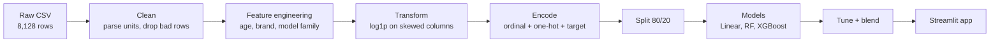

<div align="center">


<a href="https://git.io/typing-svg"></a>

<br/>


**[Live Demo](https://YOUR-APP-NAME.streamlit.app)** &nbsp;|&nbsp; **[Notebook](notebooks/car_price_prediction.ipynb)** &nbsp;|&nbsp; **[Dataset](https://www.kaggle.com/datasets/nehalbirla/vehicle-dataset-from-cardekho)**

</div>

---

## At a glance

<table align="center">
<tr>
<td align="center" width="25%"><h3>7,886</h3><sub>cleaned listings<br/>(from 8,128 raw)</sub></td>
<td align="center" width="25%"><h3>49</h3><sub>engineered<br/>features</sub></td>
<td align="center" width="25%"><h3>0.184</h3><sub>validation RMSE<br/>(log price)</sub></td>
<td align="center" width="25%"><h3>&asymp; &plusmn;20%</h3><sub>typical price error<br/>(e<sup>0.184</sup> &asymp; 1.20)</sub></td>
</tr>
</table>

---

## What this project is

A used-car price predictor built on the **CarDekho** listings dataset (`Car details v3.csv`). You enter a car's brand, model family, year, kilometres, fuel, transmission, owner count and engine specs, and the app returns an estimated resale price, a likely range, and how the two underlying models disagree.

This is **Project 3** in a series of end-to-end ML builds. Earlier projects were house prices (regression) and customer churn (classification). This one is deliberately messier: unit strings inside numeric columns, a 2,000-value categorical, heavy skew and genuinely suspicious rows.

> **Why it is interesting:** the data fights back. `torque` mixes Nm and kgm, `name` has 2,058 unique values, and the target spans from Rs 30k to Rs 1 crore. Most of the project is reasoning about *why* each fix is needed, not just applying it.

---

## Pipeline



---

## Explore the details

<details>
<summary><b>1. Data cleaning</b> &nbsp;(click to expand)</summary>

<br/>

| Problem found | What it looked like | Decision |
|---|---|---|
| Missing specs | 215 rows missing `mileage`, `engine`, `max_power`, `torque`, `seats` **together**; a few more partially broken (e.g. `seats = 0`, `max_power = "bhp"`) | Dropped. These are physical specs of a specific car, so imputing them would invent numbers |
| Unit strings | `"23.4 kmpl"`, `"1248 CC"`, `"190Nm@ 2000rpm"` | Parsed to floats |
| Mixed torque units | 504 rows in `kgm`, the rest in `Nm` | Converted kgm to Nm (x 9.80665) |
| Zero mileage | 17 petrol/diesel cars with `mileage = 0` | Dropped as data-entry errors |
| Impossible odometer | A 2011 car with `km_driven = 1` | Dropped |

**A bug worth remembering:** the first torque parser checked `'kgm' in val` anywhere in the string. A value like `380Nm(38.7kgm)@ 2500rpm` contains both units, so 380 was wrongly multiplied and became 3,726 Nm on a Ford Endeavour. The fix was matching the number *next to* each unit. It was caught only because the `describe()` max looked physically impossible.

</details>

<details>
<summary><b>2. Feature engineering</b></summary>

<br/>

| Feature | How it is built | Why |
|---|---|---|
| `age` | `2020 - year` | Depreciation depends on age, not the calendar year |
| `kmLog` | `log1p(km_driven)` | Skew 1.71 reduced; correlation with price improved (-0.30 to -0.37) |
| `powerLog` | `log1p(max_power)` | Skew 1.64 reduced to 0.39; correlation improved (0.731 to 0.740) |
| `ownerEncoded` | Ordinal: Test Drive 0, First 1, Second 2, Third 3, Fourth+ 4 | Owner count has a natural order |
| `brand_*` | One-hot over 30 brands | Avoids imposing a fake order |
| `fuel_*`, `seller_type_*`, `transmission_*` | One-hot | Low-cardinality categoricals |
| `famEnc` | Smoothed target encoding of the model family (e.g. "Maruti Swift"), fit on **training data only**, out-of-fold for training rows | Brand alone is too coarse: "Tata" covers a cheap Indica and an expensive Safari |
| `priceLog` (target) | `log1p(selling_price)` | Target was heavily right-skewed |

`name` has 2,058 unique values, so it was reduced in two steps: brand (30 values), then model family (200 values, with families under 20 training rows grouped as `Other`).

</details>

<details>
<summary><b>3. Multicollinearity check</b></summary>

<br/>

`engine`, `max_power` and `torque` move together.

| Pair | Correlation |
|---|---|
| `max_power` and `torque` | 0.78 |
| `engine` and `max_power` | 0.70 |
| `engine` and `torque` | 0.63 |

All VIFs stayed below 5 (highest: `engine` at 4.53), so **all three features were kept**. Dropping a strong price driver to fix a mild overlap is a bad trade, and the models used here tolerate it. The one consequence is *diluted feature importance*: the power-related signal is split across several columns.

</details>

<details>
<summary><b>4. Models and results</b></summary>

<br/>

Validation RMSE is measured on `log(price)`, so it is a *relative* error: 0.184 means roughly a 20% typical miss.

| Model | Val RMSE | vs Linear baseline |
|---|---|---|
| Linear Regression | 0.2455 | baseline |
| Ridge (alpha = 1) | 0.2455 | no change (no severe multicollinearity) |
| Random Forest (default) | 0.1920 | 21.8% lower |
| Random Forest (tuned) | 0.1893 | 22.9% lower |
| XGBoost (default, early stopping) | 0.1896 | 22.8% lower |
| XGBoost (tuned) | 0.1883 | 23.3% lower |
| 50/50 blend of tuned RF + XGBoost | 0.1856 | 24.4% lower |
| **Blend + `famEnc` (final)** | **0.1840** | **25.0% lower** |

**What the results say:**

- Tree models beat linear ones clearly, because price depends on **non-linear and interacting** factors (a 10-year-old BMW can still outprice a new hatchback).
- Tuning, blending and the extra feature each moved RMSE only by 0.001 to 0.005. The remaining error is mostly **information the listing does not contain**: condition, accident history, location, and some mis-priced listings.
- `famEnc` gave a small consistent gain (the 5-fold CV improvement was only 0.0005), so it is kept as a harmless one-column addition, not a breakthrough.
- Blending helped modestly because the two models' residuals correlate at 0.93, meaning they make very similar mistakes.

**Top drivers (Random Forest importance):** `powerLog` (0.44) and `age` (0.40) account for about 84% together.

</details>

<details>
<summary><b>5. Error analysis</b></summary>

<br/>

The ten worst predictions were mostly listings with suspicious prices for their age and specs (for example a 2012 Tata Safari listed at Rs 1.32 lakh against a prediction of about Rs 3.9 lakh), plausibly distress sales, damaged cars or typos. By brand, signed errors for brands with enough rows were close to zero, so the encoding is not systematically biased toward any brand.

</details>

<details>
<summary><b>6. Lessons learned</b></summary>

<br/>

- **Keep the original index** during cleaning. Calling `reset_index(drop=True)` after dropping rows broke the link back to the raw CSV and cost a debugging detour.
- **Re-check outliers after every transform.** The kgm bug only appeared in `describe()`.
- **Fit anything that learns (scalers, target encoders) on training data only.** Otherwise validation scores are optimistic.
- **Tune until the gains are inside the noise, then stop.** After the first tree model, better *features* mattered more than better *algorithms*.
- **Do not claim what you have not seen.** Several "facts" were corrected by simply reading the real output.

</details>

---

## The app

The Streamlit app reproduces the full training pipeline from raw form input and shows:

| Panel | What it shows |
|---|---|
| **Valuation ticket** | Estimated price in Indian digit grouping, plus a likely range of about +/-20% |
| **Two opinions** | Random Forest vs XGBoost estimates and the percentage gap between them (a rough confidence signal) |
| **Depreciation curve** | The same car re-priced for model years 2000 to 2020 |

> **Screenshot:** add one at `assets/app-screenshot.png`, then uncomment the line below.

<!-- <p align="center"></p> -->

---

## Run it locally

**1. Clone and install**

```bash
git clone https://github.com/YOUR-USERNAME/YOUR-REPO.git
cd YOUR-REPO
python -m venv .venv
source .venv/bin/activate        # Windows: .venv\Scripts\activate
pip install -r requirements.txt
```

**2. Start the app**

```bash
streamlit run app.py
```

The app expects these files next to `app.py`: `xgbModel.json`, `rfModel.pkl`, `preprocess.pkl`, `defaults.pkl`.

**3. Rebuild the models (optional)**

Open `notebooks/car_price_prediction.ipynb` in Google Colab, download `Car details v3.csv` from the Kaggle dataset linked above, and run the notebook top to bottom. It writes the four model files at the end.

> **Version note:** `rfModel.pkl` is a pickle, so `scikit-learn` in `requirements.txt` must match the version used to train it. The XGBoost model is saved in native JSON and does not have this problem.

---

## Project structure

```text
.
├── app.py                      # Streamlit app
├── requirements.txt
├── .streamlit/
│   └── config.toml             # forces the light theme
├── xgbModel.json               # XGBoost (native format)
├── rfModel.pkl                 # Random Forest (compressed pickle)
├── preprocess.pkl              # feature order + family encoding map
├── defaults.pkl                # typical values for fields the form skips
├── car-sketch.svg              # animated header
├── notebooks/
│   └── car_price_prediction.ipynb
└── README.md
```

---

## Limitations

- **Data ends at model year 2020**, so the app caps the year slider there. Newer cars would be extrapolation.
- **No condition, accident history or location** in the data, which sets a noise floor of roughly 20% error.
- **Rare model families** fall into an `Other` bucket and get less specific estimates.
- Prices reflect the dataset's listings, not live market data.

## Future work

- Refit the final models on train + validation data
- Add trim-level information (e.g. VXI vs ZXI) from the raw `name`
- Cross-validated confidence intervals instead of a fixed +/-20% band
- Refresh the dataset with recent listings

---

## Tech stack

`Python` &middot; `pandas` &middot; `NumPy` &middot; `scikit-learn` &middot; `XGBoost` &middot; `statsmodels` (VIF) &middot; `Matplotlib` &middot; `Seaborn` &middot; `Streamlit`

## Acknowledgements

Dataset: [CarDekho vehicle dataset](https://www.kaggle.com/datasets/nehalbirla/vehicle-dataset-from-cardekho) on Kaggle.

---

<div align="center">

**If this helped you, consider giving the repo a star.**


</div>
